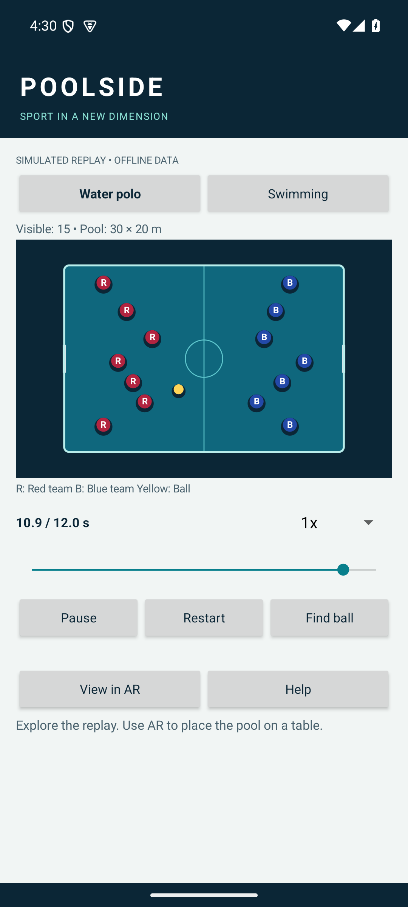
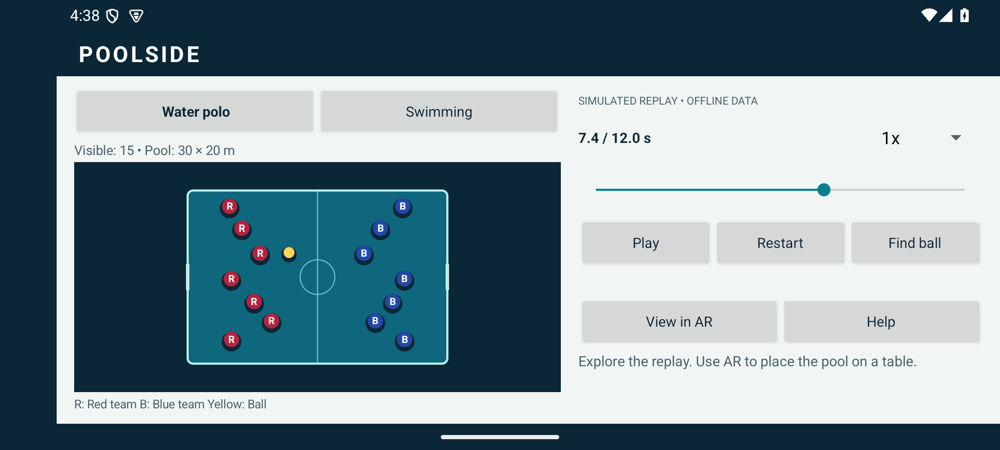
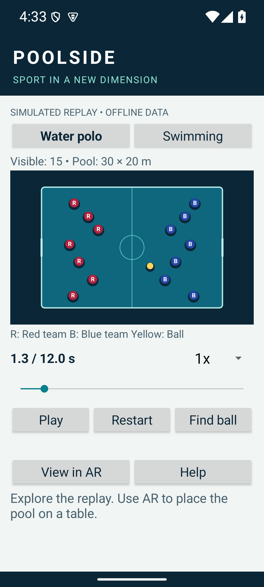
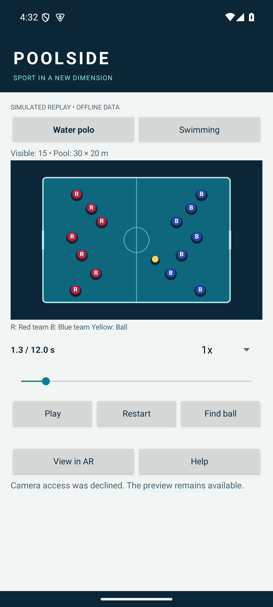

# UI effectiveness

## Task-focused decisions

- The first screen renders a replay immediately and clearly labels it simulated. Camera access is an explicit opt-in action.
- Sport selection, visible-entity count, pool dimensions, timeline, and speed are grouped around the visualization. Playback and challenge buttons have direct labels and minimum 48 dp height.
- Team markers use R/B labels as well as distinct colors. Swimming lanes use numbers. Text has a dark-on-light control palette; the pool visualization uses a separate dark canvas.
- Seeking and changing speed support inspection of short events. Paused/playing labels reflect actual model state.
- Find ball explains the action and pauses the replay. An accessible coordinate-entry dialog complements spatial tapping, validates bounds, and leaves invalid input editable.
- Unsupported AR and camera denial retain preview. Tracking instructions explain scanning, lighting, placement, and retry. Place again is shown only in AR.
- Portrait controls scroll; ordinary landscape uses a complete pool beside an independently scrolling control pane. Small-height or enlarged-text landscape falls back to one scrollable column; system insets protect them from system bars. Text uses sp units. Rotation preserves replay settings and returns to a usable preview.
- Help explains the synthetic data, controls, challenge radius, and AR privacy link.

## Evaluation method

Automated emulator tests cover entry without camera permission, pause/resume, sport selection and challenge availability, coordinate-based completion, invalid input recovery, activity recreation, Help, and restart. Screenshots in this directory are actual emulator captures, not design mockups. The validation report distinguishes executed checks from planned hardware checks.

These are engineering and heuristic checks, **not a user study**. No satisfaction score, task-completion rate, or accessibility certification is claimed. The custom canvas has a description and the challenge has an alternative input, but individual moving athletes are not separate TalkBack nodes.

## Suggested classroom user study

Ask at least five participants to locate a swimmer, pause at a given time, switch sport, complete a challenge, and enter/exit AR. Record completion without assistance, errors, completion time, and a short explanation of confusing controls. Separately test TalkBack traversal and enlarged text. Report sample size and results without generalizing a small classroom sample to all users.

## Remaining physical-device checks

AR plane discovery, anchor stability while walking around the table, touch-to-world accuracy, lighting recovery, background/resume camera release, and battery/thermal behavior require an ARCore-supported phone. A camera-free emulator result cannot establish these qualities.

## Captured screens

